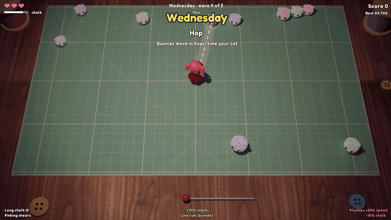
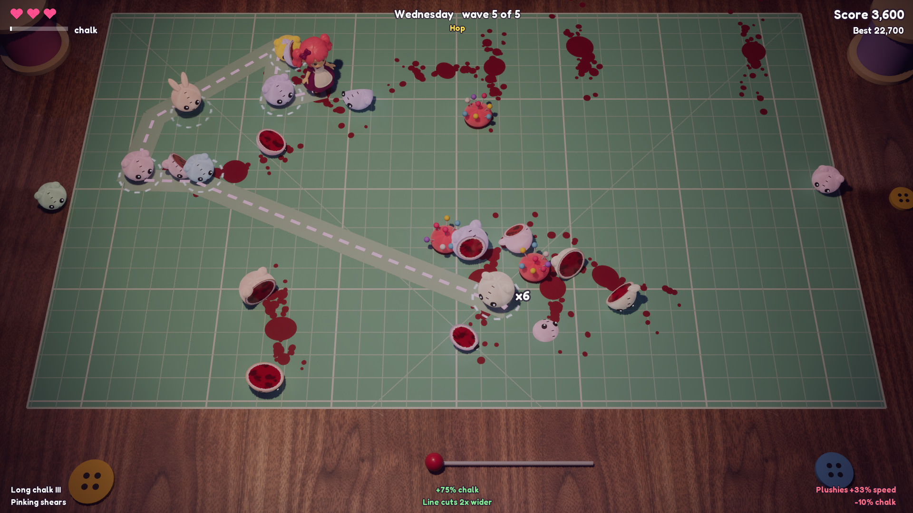
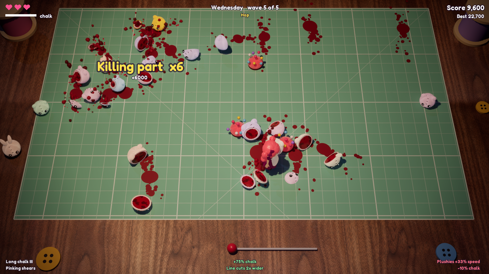
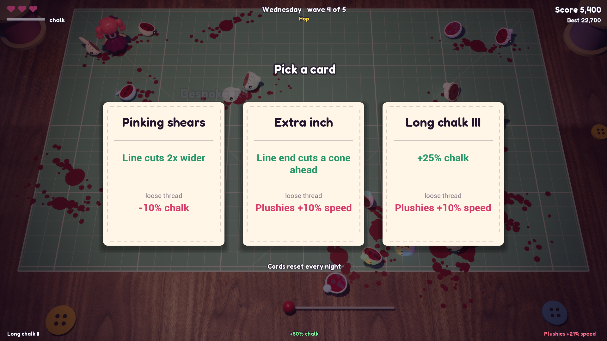
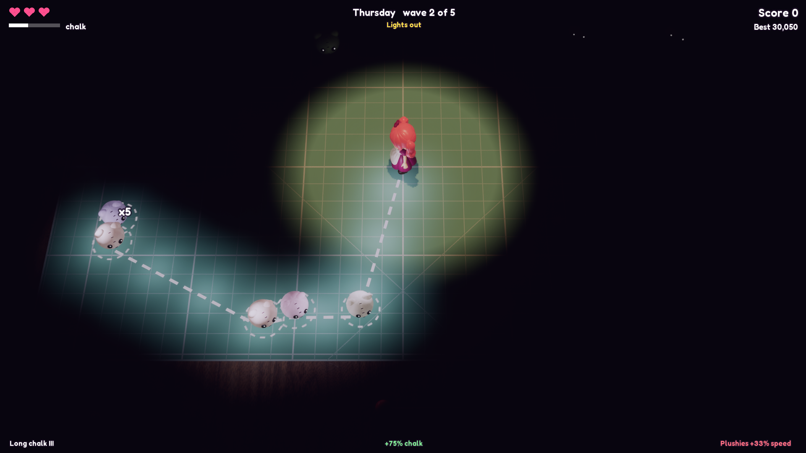
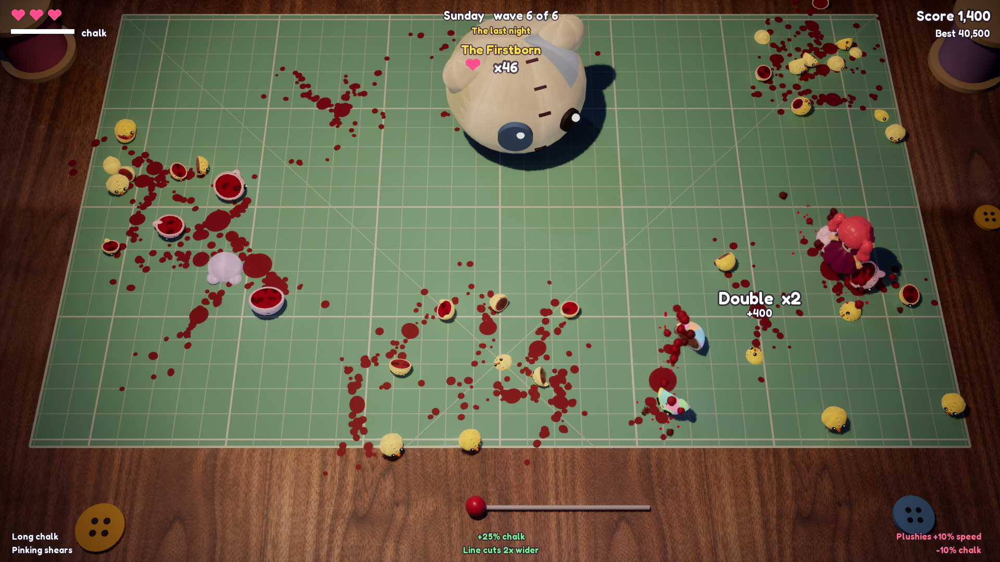
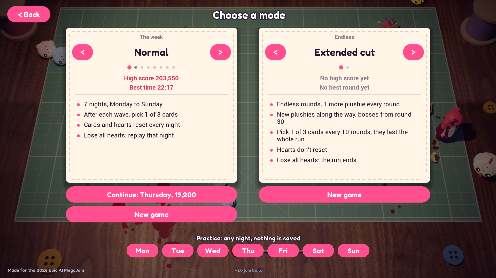
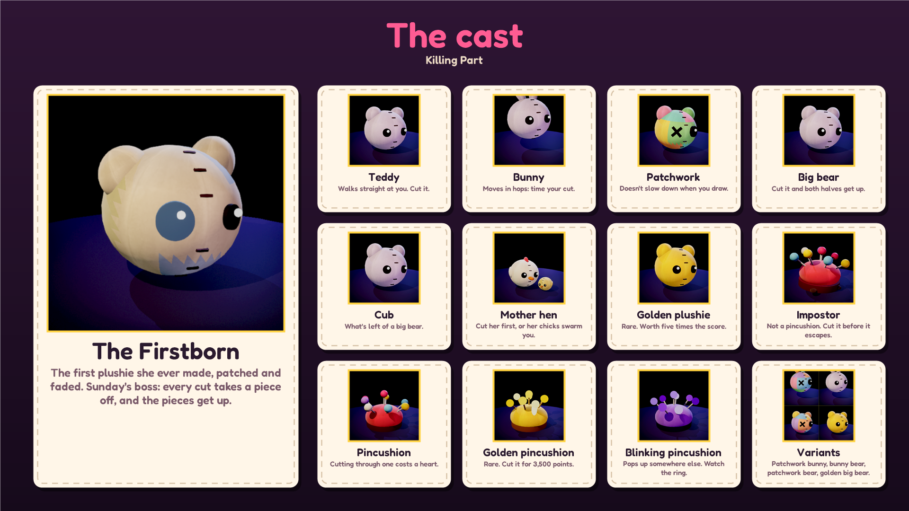
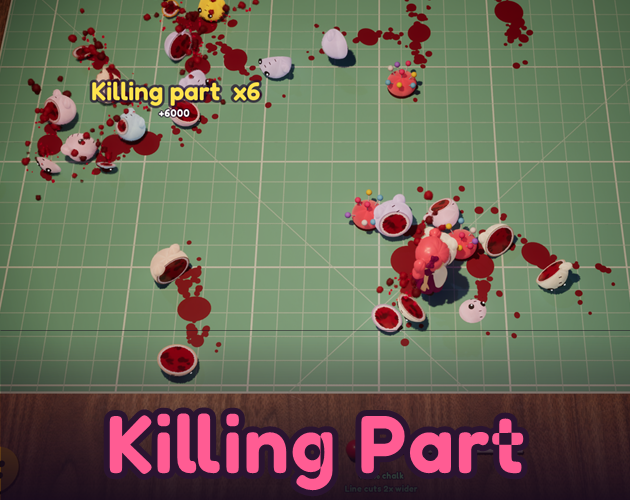

# Killing Part

A seamstress's plushies come alive at night, and they want hugs. Deadly ones. Hold the mouse and time almost stops while you draw her cut in tailor's chalk; let go and she dashes along the line with giant shears, and everything she passed through falls in half. Cut five at once and the game calls it out: **Killing part**.

A one-screen arcade game for Windows, made in four days for the 2026 Epic AI MegaJam.

| | |
| --- | --- |
|  |  |
|  |  |
|  |  |

## Video

*(Video coming soon.)*

## Download

**[Get the Windows build from Releases](../../releases/latest)**: unzip it and run `KillingPart.exe`. Windows 10/11, 64-bit, mouse only. The first launch compiles shaders for about 40 seconds ("Preparing..." in the corner); it isn't frozen.

The game asks at first launch which version you want: the **Director's cut** (cartoon blood) or the **Theatrical cut** (white stuffing, no blood). You can switch any time.

## The jam

The Epic AI MegaJam ran from 12 to 15 November 2026, with the theme **Director's Cut**. Killing Part takes it two ways: you direct every cut yourself, and the game comes in two cuts, the Director's and the Theatrical. Every line of gameplay code was written during the jam.

The jam entry, with the description, the screenshots and the build, is on itch.io:

**[Killing Part on itch.io](https://ITCH_USER.itch.io/killing-part)**

## How it was made

Four days, one person, two Claudes:

- **Claude in chat** for the design: the pitch, the rules, the cut list, reading playtests, and writing the prompt for each build task.
- **Claude Code** for all the code: about 12,700 lines of C++ in Unreal Engine 5.9, plus the editor Python scripts that build the materials. It built, tested (with a bot that plays the game by itself), took the screenshots and kept the notes.
- I played every build and made the design calls.

The whole record is in [docs/](docs): the design brief ([DESIGN.md](docs/DESIGN.md)), the dated dev notes ([DevNotes.md](docs/DevNotes.md)), Claude Code's standing brief ([CLAUDE.md](docs/CLAUDE.md)), and every prompt in order in [docs/process](docs/process).

The game started as a browser sketch of the core loop, [Prototype/KillingPart_Toy.html](Prototype/KillingPart_Toy.html): open it in a browser and play it.

### Why the C++ module is called CardIsland

The first idea was a different game, Card Island. On day 2 it was dropped as too big for the jam and the project became Killing Part. The project and its targets were renamed, but the C++ module kept its name: renaming a module breaks every Blueprint and config reference to it, and with two days left that wasn't worth it.

## Code map

All the game code is in [Source/CardIsland/KillingPart](Source/CardIsland/KillingPart). The classes are prefixed `KP`.

| File | What it does |
| --- | --- |
| `KPDirector.h/.cpp` | The game: one actor that runs everything. Waves, plushie movement, drawing the line in slow motion, the dash, the beat and the snip, hearts, score, cards, pincushions, the particles, stains and splats, camera shake and camera cuts. |
| `KPDirectorMenu.cpp` | Title screen with the mat playing itself, modes, Practice, pause, the tutorial, meet-a-new-plushie introductions, the wardrobe, and every button's action. |
| `KPDirectorWeek.cpp` | The week: loading the data and the save, recording each night's result, the calendar. |
| `KPDirectorBoss.cpp` | Sunday's boss, The Firstborn: chunks sliced off per hit, chunks that get up, enrage, the finale. |
| `KPDirectorAudio.cpp` | All sound: roles and picks from the JSON, music crossfades, ducking while drawing, the sound test. |
| `KPPlushie.h/.cpp` | One plushie: a procedural, sliceable body with button eyes and ears; `Slice()` cuts it along the line into two physics halves with a layered cap. |
| `KPMeshGen.h/.cpp` | Procedural meshes: the plushie body (UV sphere, patchwork variant) and convex hulls for the cut halves. |
| `KPPincushion.h/.cpp` | The hazard: normal, golden and blinking pincushions. |
| `KPHeroine.h/.cpp` | The seamstress: her model, the shears, and all her animation in code (turning, breathing, dash lean and stretch, squash, hurt shake). |
| `KPPortrait.h/.cpp` | A small lit stage far above the table, filmed into a render target for the introduction portraits. |
| `SKPHud.h/.cpp` | The whole UI in Slate: HUD, cards, menus, results, ending and credits. |
| `KPTypes.h/.cpp` | Data types for everything in `KillingPart.json` (tuning, plushie types, nights, cards, modes, audio), plus shared maths and colour helpers. |
| `KPSave.h/.cpp` | The save game. |
| `KPCommands.cpp` | `kp.*` console commands for testing (compiled out of Shipping). |
| `KPGameMode`, `KPPlayerController` | Game mode, cursor and mouse input. |

Everything the game is tuned with (speeds, nights, waves, cards, texts, sounds) lives in a JSON file in Content, read at every restart, so balancing needed no recompiles.

Other folders:

- [Tools](Tools): editor Python scripts that build the materials (`build_cap_material.py` for the cut face, `build_pbr_materials.py`, `build_heroine_material.py`), `BuildEditor.bat`, the test runner and the release README.
- [Art](Art): source art made for the game: the heroine model (Tripo AI) and the plush and walnut textures (PBRgen).
- [Config](Config): the project's Unreal config.

## What isn't here

Content and audio are not included in the repo for licence reasons; the playable build is in Releases.

That means the project won't open as a playable game from this repo alone: the maps, materials, data file and sounds live in Content, which stays private.

## Credits and tools

- Design, code direction and playtesting: Simon (omgxdlmao)
- Code, tools and docs: Claude Code (Anthropic); design partner: Claude (Anthropic)
- Engine: Unreal Engine 5.9
- Version control: Diversion
- Heroine model: Tripo AI
- Fabric and wood materials: PBRgen
- Sound and music: WeLoveIndies (weloveindies.com)
- Font: Fredoka by The Fredoka Project Authors (SIL Open Font Licence 1.1)

## Licence

All rights reserved. The code is here to read and learn from; it is not open source.
